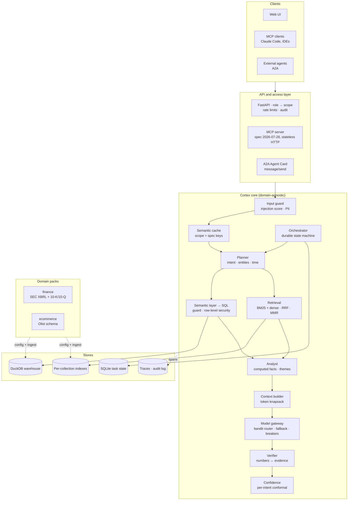
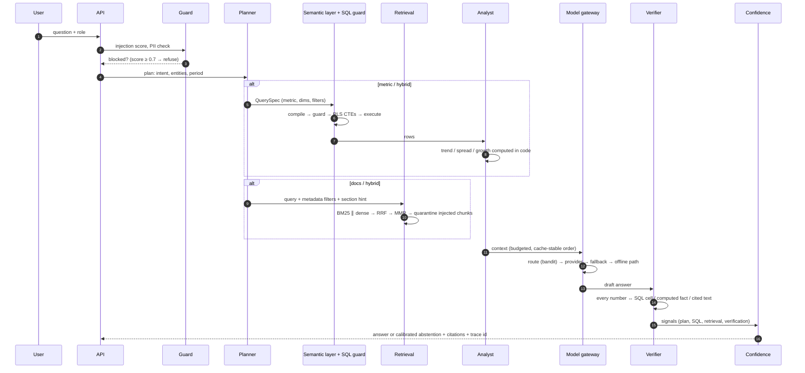
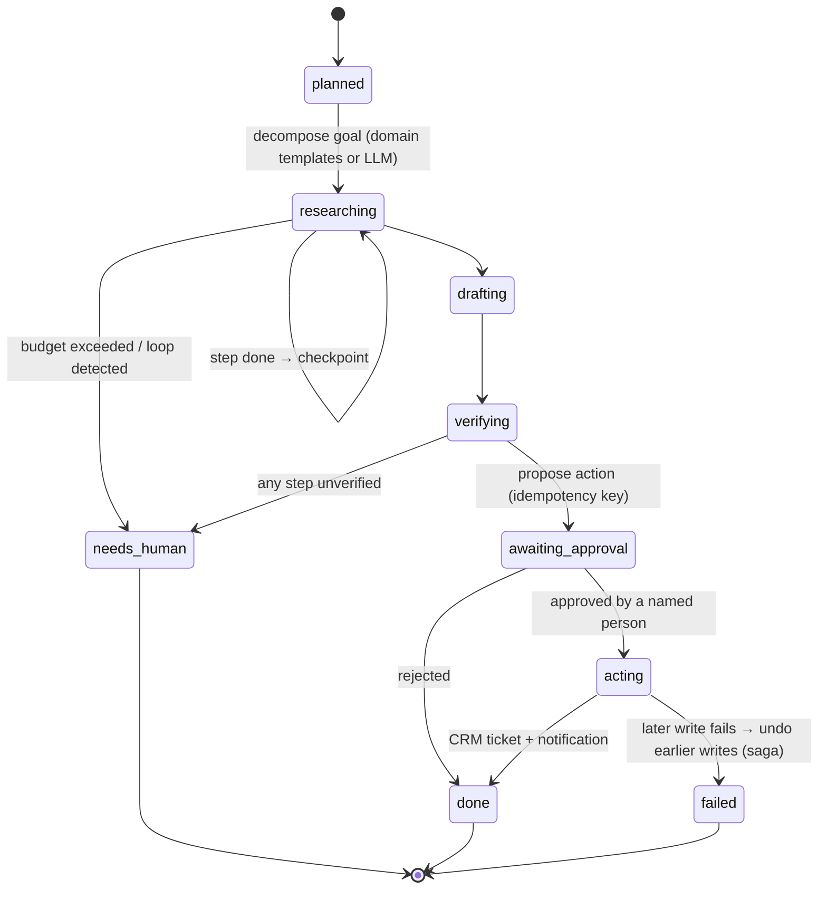

# Architecture

Cortex is a layered GenAI platform. Every request passes an input guard and a policy check before it reaches a model or any data, and every number in an answer is checked against its source before the answer leaves the system. Domain knowledge lives in pluggable domain packs, so the core never names a business domain.

**Status legend used across the docs:** **Built · measured** means the component is in this repository, covered by tests, and its numbers come from `evals/<domain>/REPORT.md`. **Designed** means the approach, interfaces and test plan are specified but not yet implemented; see [roadmap.md](roadmap.md).

## 1. System overview

## 2. One question, end to end

## 3. Multi-step agent task

A crash at any point resumes from the last checkpoint: completed steps are not re-run (tested by injecting a crash after step 2).

## 4. Design principles

| Principle | How it shows up |
| --- | --- |
| The model chooses, code computes | The LLM picks a metric and filters (QuerySpec); SQL and every number are produced by code. |
| Nothing unverified leaves | The verifier checks each number; failures trigger one rewrite, then lower confidence or human review. |
| Abstain rather than guess | Per-intent conformal thresholds; entities known to be absent ("Tesla") are declined explicitly. |
| Security at the seams | Input guard, chunk quarantine, SQL guard, row-level security, tool policy, human approval — each tested. |
| Measure every decision | Each design record cites a number from the eval lab; CI blocks regressions. |
| Degrade, don't fail | No API key or every provider down → deterministic offline path with the same verification. |
| Domain-agnostic core | All domain knowledge in `domains/<name>/`; adding finance changed no core logic. |

## 5. Code map

| Concern | Path |
| --- | --- |
| Domain pack loader | `cortex/domain.py` |
| Ingestion, schema profiling, lineage | `cortex/ingest/` + `domains/*/pack.py` |
| Retrieval | `cortex/retrieval/index.py` |
| Semantic layer, text-to-SQL, planner | `cortex/retrieval/semantic_layer.py`, `text2sql.py`, `planner.py` |
| Context builder | `cortex/context/builder.py` |
| Gateway, router, cache | `cortex/gateway/` |
| Pipeline, analyst, verifier, orchestrator | `cortex/agents/` |
| Confidence and conformal | `cortex/uncertainty/conformal.py` |
| Security | `cortex/security/` |
| Evaluation lab | `cortex/evals/` |
| API, MCP, A2A, UI | `cortex/api/` |
| Tracing | `cortex/telemetry/tracer.py` |

## 6. Layer deep dives

1. [Ingestion and domain packs](layers/01-ingestion-and-domain-packs.md)
2. [Retrieval](layers/02-retrieval.md)
3. [Semantic layer and text-to-SQL](layers/03-semantic-layer-text-to-sql.md)
4. [Context engineering](layers/04-context-engineering.md)
5. [Model gateway, router and cache](layers/05-model-gateway.md)
6. [Agents and orchestration](layers/06-agents-orchestration.md)
7. [Verification and uncertainty](layers/07-verification-uncertainty.md)
8. [Integration: MCP, A2A, live APIs](layers/08-integration.md)
9. [Observability and LLMOps](layers/09-observability-llmops.md)

Cross-cutting: [Security](security.md) · [Evaluation](evaluation.md) · [Deployment](deployment.md) · [Roadmap](roadmap.md) · [Design records](adr/)
