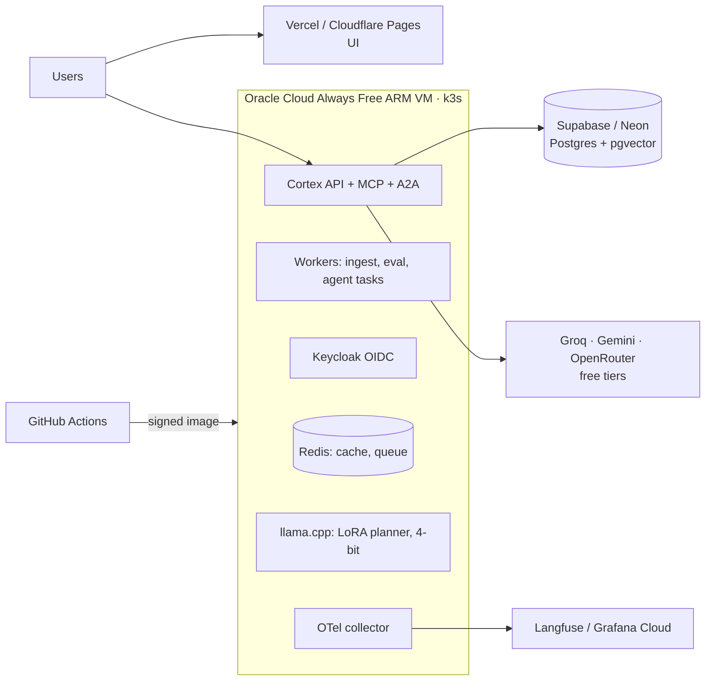

# Deployment and delivery

**Built:** Dockerfile, docker-compose, GitHub Actions CI with the eval gate. **Designed:** everything else on this page.

## What runs today
- `docker compose up --build` builds an image that ingests data and runs the eval at build time, then serves the UI, API and MCP on port 8000 with a healthcheck.
- CI on every push: lint → 40 tests → ingest → full evaluation → gate. The report is uploaded as a build artifact.

## Free-tier topology (Designed)

## Production mapping (Designed)

| Concern | AWS | Azure |
| --- | --- | --- |
| Compute | EKS | AKS |
| Warehouse and vectors | RDS Postgres + pgvector, or Aurora | Azure Database for PostgreSQL + pgvector |
| Models | Bedrock (Claude, Llama), private endpoints | Azure OpenAI, private endpoints |
| Identity | Cognito / IAM Identity Center | Entra ID |
| Secrets | Secrets Manager | Key Vault |
| Observability | CloudWatch + managed Grafana | Monitor + managed Grafana |
| Data residency | Region pinning; no cross-region replication of customer data | Same |

## Release process (Designed)
1. **Release bundle:** prompts, model IDs and parameters, tool definitions and domain config, versioned together (`bundle-1.4.0`) with a signed manifest. Every trace records its bundle.
2. **Shadow:** the new bundle runs on copied traffic and is compared with the old; users see the old.
3. **Canary:** 5–10% of traffic. Promotion uses a sequential test on judged quality, cost and p95 latency, so it can stop early without inflating false positives.
4. **Full rollout**, with **one-command rollback** that re-points traffic to the previous bundle.

## Supply chain (Designed)
SBOM (Syft), vulnerability scan (Grype/Trivy), secret scan (gitleaks), images signed with cosign, multi-arch builds for ARM.

## Cost model (Designed)
Cost per query = Σ over calls (input + output tokens × price) − cache savings + infrastructure share. It is reported for pilot, department and enterprise volumes at list prices, next to the free-tier demo cost of $0. The bandit router's budget constraint ([layer 5](layers/05-model-gateway.md)) is the lever that keeps cost per query within a client's target.

## Delivery playbook for a client engagement
1. **Discovery (week 0–1):** map workflows and data sources, assess risk, and score use cases on value × feasibility.
2. **Data readiness:** access, quality checks, PII review, and the permission model, which becomes `policies.yaml`.
3. **Pilot (4–6 weeks):** one domain pack, a golden set written with client experts, and success metrics agreed up front.
4. **Sign-off:** the eval report, red-team report and cost model.
5. **Rollout:** SSO, training, champions in each team, and a feedback loop into the golden set.
6. **Operate:** response-time targets, runbooks, a quarterly refresh of the evaluation, and cost reviews.
