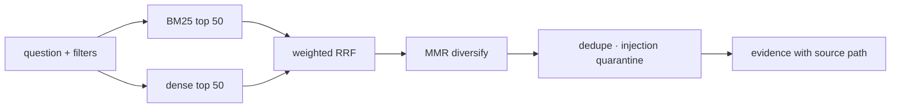

# 2. Retrieval

**Status: Built · measured** (real embedding model and cross-encoder reranker: Designed)

## Problem
Answers are only as good as the evidence found. Keyword search misses paraphrases; vector search misses exact names, codes and rare terms; a single shared vector space is dominated by whichever collection is largest.

## Design



- **BM25** (own implementation, k1 = 1.5, b = 0.75) over `section path + text`.
- **Dense**: LSA (TF-IDF → truncated SVD, 192 dims, L2-normalised) so the system runs offline; `CORTEX_EMBEDDER=st` swaps in a sentence-transformers model behind the same interface.
- **One index per collection** (policies vs reviews; filings), each with its own statistics and embedding space (ADR-004).
- **Metadata filters** before ranking: ticker, category, state, review score, role scope.
- **Section routing** from `domain.yaml`: "risk" questions search Risk Factors first, "why/drove" questions MD&A, falling back to all sections if nothing matches.
- **Per-entity search** for comparisons, so "compare Apple and Microsoft" retrieves evidence for both.

## Maths

BM25 term score:

```
score(q, d) = Σ_t  idf(t) · tf(t,d)·(k1+1) / ( tf(t,d) + k1·(1 − b + b·|d|/avgdl) )
idf(t)      = ln(1 + (N − df(t) + 0.5) / (df(t) + 0.5))
```

Weighted reciprocal rank fusion (rank-based, so BM25's unbounded scores and cosine similarities need no calibration):

```
RRF(d) = Σ_r  w_r / (60 + rank_r(d))
```

Maximal marginal relevance, λ = 0.7:

```
MMR = argmax_{d ∈ C\S}  λ·rel(d) − (1−λ)·max_{s ∈ S} sim(d, s)
```

## Results (from the eval reports)

| Corpus | Retriever | Recall@3 | Recall@1 | MRR |
| --- | --- | --- | --- | --- |
| Finance: 1,375 SEC passages, 11 questions | BM25 | 81.8% | 63.6% | 0.727 |
| | LSA dense | 63.6% | 54.5% | 0.576 |
| | Hybrid | 81.8% | 63.6% | 0.727 |
| E-commerce: 18 policy sections, 22 questions | BM25 | 100% | 95.5% | 0.977 |
| | LSA dense | 100% | 90.9% | 0.955 |
| | Hybrid | 100% | 95.5% | 0.977 |

Reading: on real filings, the offline LSA embedder is clearly weaker than BM25, and fusion currently adds nothing over BM25. The known miss ("Where does NVIDIA manufacture its chips?" → the TSMC passage) is a vocabulary mismatch that lexical methods cannot fix. Two experiments were measured and rejected: a heavier suffix stemmer (lowered both domains) and stricter stopwords (ADR-019).

## Next (Designed)
1. Real embeddings (`bge-small` / `nomic-embed`) — expected to lift dense recall and the TSMC case.
2. Cross-encoder reranker (`bge-reranker`) on the fused top 20.
3. HNSW tuning study: recall@10 vs latency across `ef_search`; int8/binary quantization recall vs memory.
4. Learned fusion weights per intent from golden-set relevance labels.
