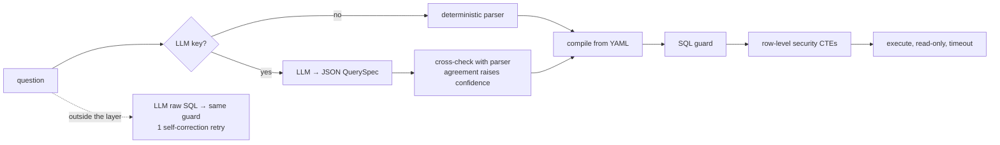

# 3. Semantic layer and text-to-SQL

**Status: Built · measured** (LLM spec path written, not yet run against a live model)

## Problem
The most common text-to-SQL failure is SQL that runs and returns a plausible but wrong number: wrong join grain, wrong denominator, an average of ratios instead of a ratio of sums. A user cannot spot it.

## Design: the model chooses, code computes



**QuerySpec** = metric + dimensions + filters (entities, year / quarter / month, `recent` N periods) + order + limit. Metrics are defined once in `semantic_layer.yaml`:

```yaml
gross_margin:
  sql: "ROUND(SUM(gross_profit) / NULLIF(SUM(revenue), 0), 4)"   # ratio of sums
  format: percent
  synonyms: ["gross margin", "gm"]
```

The compiler handles:
- **Time:** calendar-quarter, year and month expressions per domain. "Last 8 quarters" becomes `period_rank <= 8` plus a quarter dimension; with no period given, the latest reported quarter is used.
- **Entities:** glossary matching where the longest match wins. "Office furniture" is not misread as "furniture".
- **Comparisons:** "Compare Apple and Microsoft" groups by company, giving one series per company.
- **Small samples:** a minimum group size keeps categories with too few orders out of rankings.
- **Customer-grain metrics:** repeat-customer rate is computed over one row per customer, not per order.
- **Grouping:** GROUP BY uses the expression, not the alias. An alias can collide with a real column: `company` in the finance view.

## Example (finance, real data)

Question: *Which company had the highest operating margin in the latest quarter?*

```sql
SELECT ticker AS company,
       MAX(fiscal_label || ', ended ' || CAST(period_end AS VARCHAR)) AS period,
       ROUND(SUM(operating_income) / NULLIF(SUM(revenue), 0), 4) AS operating_margin
FROM fin_view WHERE period_rank <= 1
GROUP BY ticker ORDER BY operating_margin DESC NULLS LAST LIMIT 5
```

Answer: NVDA 66.2%, MSFT 49.8%, GOOGL 31.8%, AAPL 31.1%, AMZN 13.9%. All numbers verified.

## Results
| Domain | Question type | Accuracy |
| --- | --- | --- |
| Finance | Point values (38), rankings (6), 8-quarter trends (4) | 100% |
| E-commerce | Point values (54), rankings (6), trends (2) | 100% |

Gold answers are computed independently: SEC frames for finance, and hand-written SQL on base tables (not the view) for e-commerce.

## Alternatives considered
- **Free-form LLM SQL:** flexible, but every metric definition is re-invented on every call and can't be audited. It is kept only as a guarded fallback for questions outside the layer.
- **Average of per-row ratios for margins:** gives a small quarter the same weight as a large one. Rejected in favour of ratio of sums.

## Next (Designed)
Running the LLM spec path against Groq/Gemini and measuring spec agreement with the parser. Also schema linking by embedding the column descriptions, for raw-SQL questions over wide schemas.
