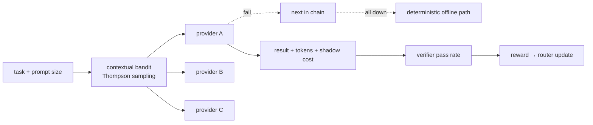

# 5. Model gateway, router and cache

**Status: Built · measured** (router measured in simulation; live-provider routing Designed)

## Problem
Teams usually hard-code one frontier model for every call. That overspends on easy steps such as classification, fails when the provider is down, and pays again for questions already answered.

## Design



- **Adapters:** one OpenAI-compatible adapter covers Groq, Gemini and OpenRouter.
- **Reliability:** 2 retries with jittered exponential backoff, a per-provider circuit breaker (opens after 3 consecutive failures, half-opens after 60 s), a fallback chain, then a deterministic offline path, so the system degrades instead of failing.
- **Shadow cost:** free tiers cost nothing, but the router optimises against list prices, so the policy carries over to paid use.

### Router maths
Context x = [bias, task one-hot, log(prompt tokens)/10]. Each model is an arm with a linear reward model; Thompson sampling draws

```
θ_a ~ N(θ̂_a, v² A_a⁻¹),   choose argmax_a x·θ_a
reward r = quality − λ·cost − μ·latency
λ ← max(0, λ + η·(cost − budget))      (dual ascent on the budget constraint)
```

Quality is the verifier's pass rate for that answer, so the router learns from the system's own checks rather than from a guess.

### Semantic cache
A hit requires all of:
- the same role scope and data version;
- the same canonical key: the compiled QuerySpec for metric questions, or the literals (numbers, codes) plus glossary entities for everything else;
- for non-metric questions, cosine similarity ≥ 0.97 and token Jaccard ≥ 0.4.

## Results
**Router (simulation with known ground truth, 3 arms × 3 task types, 3,000 calls):**

| Policy | Cost per call | Mean quality |
| --- | --- | --- |
| Always frontier | 0.0060 | 0.917 |
| Bandit (budget 0.0025) | 0.0025 | 0.882 |

The bandit costs 58.7% less for 3.5 quality points, and spend converges to the budget.

**Cache (paraphrase pairs from the golden sets):**

| Keying | Precision | False hits |
| --- | --- | --- |
| Embedding only, τ = 0.97 (e-commerce) | 4.1% | 140 |
| Production keys (e-commerce) | 100% | 0 |
| Embedding only, τ = 0.9 (finance) | 38.5% | 16 |
| Production keys (finance) | 100% | 0 |

Reading: embeddings alone treat "revenue in 2017" and "revenue in 2018" as the same question. Canonical keys fix that, at the cost of recall (about 46–65% of true paraphrases hit), which is the right trade for a cache.

## Next (Designed)
Live routing between Groq / Gemini / OpenRouter with verifier rewards; a LoRA-tuned 1–3B planner as a cheap arm ([roadmap](../roadmap.md)); a provider-outage chaos test.
